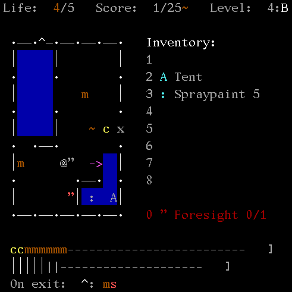

# Fear of View
A terminal broughlike game about manipulating vision.

Released under the AGPL, version 3 or later. See COPYING.

## Building
Dependencies:
* GHC and cabal: package `cabal-install` on Debian, `dev-haskell/cabal` on Gentoo, etc.
* ncurses

Run with `cabal run`.
Install with `cabal install`.
