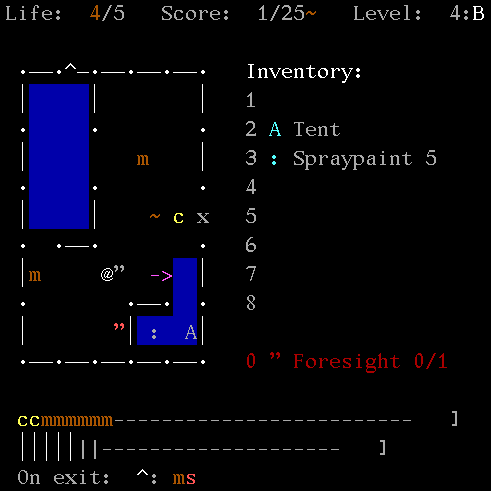

# Fear of View
A terminal broughlike game about manipulating vision.



Released under the AGPL, version 3 or later.

* [Changelog](CHANGELOG.md)

## Play by ssh
* ssh fov@sshgames.thegonz.net
* Password: fov

## Source
* [Source tarball](fearOfView-0.2.0.0.tar.gz)
* Source repository: `git clone https://thegonz.net/~fov/fearOfView.git`
* [Browsable source tree on Hackage](https://hackage.haskell.org/package/fearOfView/src/)

## Binaries
### Windows binary
Unpack the following zip and run `fearOfView.exe`.

* [fearOfView-0.2.0.0-x86\_64-mingw-bear.zip](fearOfView-0.2.0.0-x86_64-mingw-bear.zip)

## Cabal
This is the most versatile installation method, but requires you to have cabal-install and ncurses installed. It should then just be a matter of:

```
cabal update && cabal install fearOfView
```

If you want to build with Bearlibterminal instead of ncurses, obtain the source and read the README.

## Feedback
I welcome feedback by email to [mbays@sdf.org](mailto:mbays@sdf.org).
